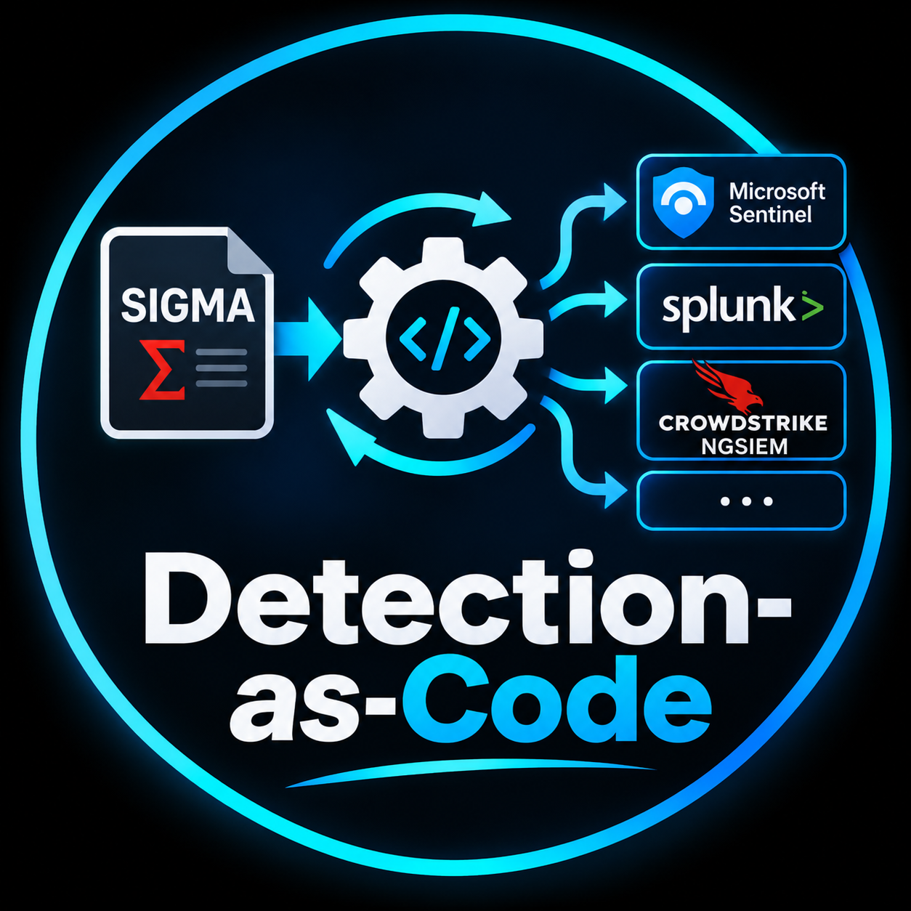

<a id="readme-top"></a>

<!-- PROJECT LOGO -->
<br />
<div align="center">
  

  <h3 align="center">Detections-as-Code</h3>

  <p align="center">
    Detection-as-Code transpilation from Sigma -> SIEM rules
    <br />
    <a href="https://github.com/deepdivesecurity/detections-as-code/issues/new?labels=bug&template=bug-report---.md">Report Bug</a>
    &middot;
    <a href="https://github.com/deepdivesecurity/detections-as-code/issues/new?labels=enhancement&template=feature-request---.md">Request Feature</a>
  </p>
</div>

[](https://github.com/deepdivesecurity/detections-as-code-starter/actions/workflows/ci.yml)
[](https://github.com/deepdivesecurity/detections-as-code-starter/actions/workflows/deploy-staging.yml)
[](https://github.com/deepdivesecurity/detections-as-code-starter/actions/workflows/deploy-production.yml)

<!-- ABOUT THE PROJECT -->
## About The Project

Contains the GitHub Actions workflow for detection-as-code transpilation from Sigma -> SIEM rules.

<p align="right">(<a href="#readme-top">back to top</a>)</p>

<!-- GETTING STARTED -->
## Getting Started


### Prerequisites
- TBD for CD flow

### Installation
1. Clone the repo
   ```sh
   git clone https://github.com/deepdivesecurity/detections-as-code-starter.git
   ```

2. Navigate to the project directory
   ```sh
   cd detections-as-code-starter
   ```

3. Sync uv and install requirements
   ```sh
   uv sync
   ```

4. Install pre-commit
   ```sh
   uv run pre-commit install
   ```

<p align="right">(<a href="#readme-top">back to top</a>)</p>

## Usage

### Converting Sigma rules with the CLI locally
1. Confirm directories exist
   ```sh
   mkdir -p converted_rules/okta
   ```
2. Convert Sigma rule to desired output language
   ```sh
   sigma convert -t "splunk" "rules/cloud/okta/okta_user_account_locked_out.yml" -p "splunk_windows" > "converted_rules/okta/okta_user_account_locked_out"
   ```

<p align="right">(<a href="#readme-top">back to top</a>)</p>

## Roadmap

See the [open issues](https://github.com/deepdivesecurity/detections-as-code-starter/issues) for a complete list of proposed features and known issues.

<p align="right">(<a href="#readme-top">back to top</a>)</p>

## Additional Documentation/References
- [SigmaHQ Sigma GitHub](https://github.com/sigmahq/sigma)

<p align="right">(<a href="#readme-top">back to top</a>)</p>

## License
All Rights Reserved.

<p align="right">(<a href="#readme-top">back to top</a>)</p>
